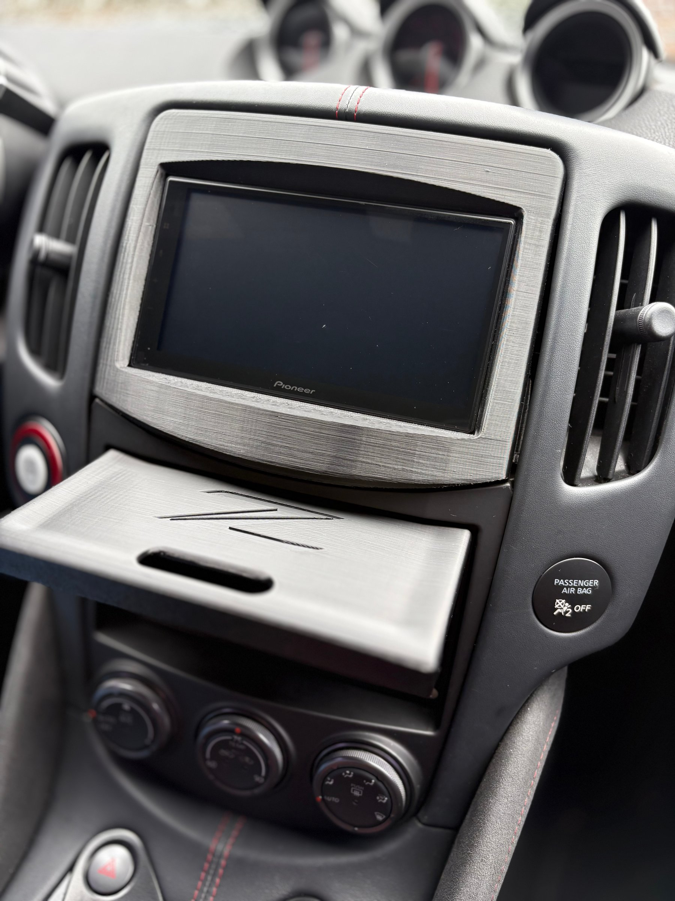
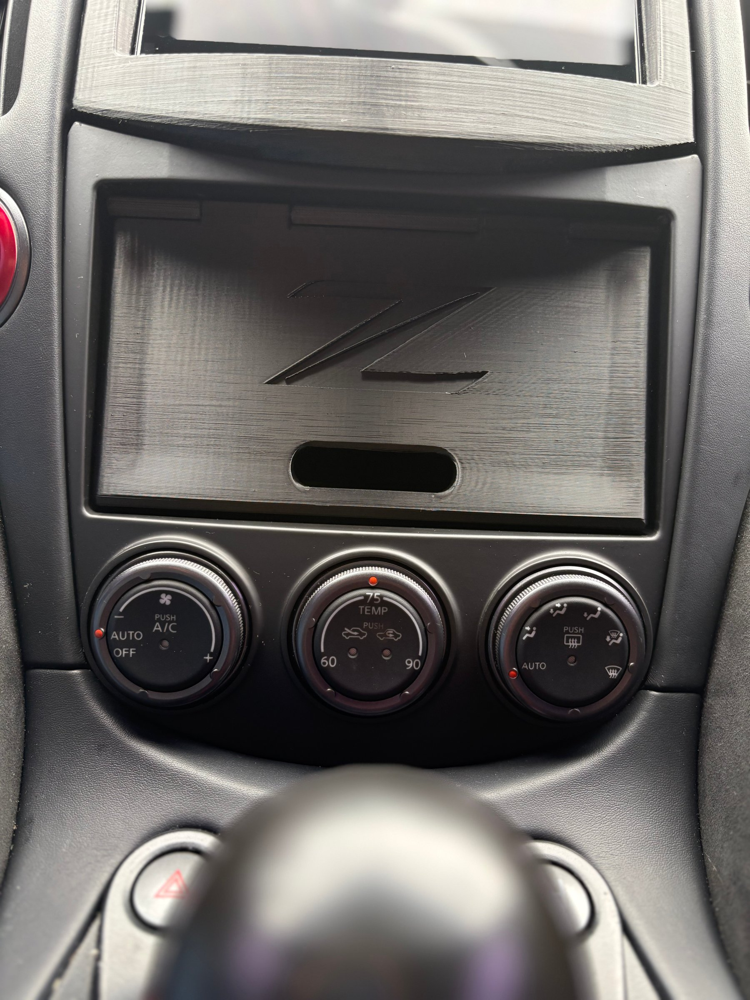

# 370Z Storage Box (aftermarket dash kit)

Licensed CC BY-SA 4.0 (see the repository [LICENSE](../../LICENSE)). Credit: 50th Z.

A drop-in storage compartment for the lower center stack of the Nissan 370Z, in two styles:

- **Hinged box**: a box with a flip-down door. The door comes with or without a Z emblem, in a curved or flat style.
- **Open box**: the same compartment with no door.

The cavity is deep enough for an iPhone Plus or smaller and a pair of sunglasses.

## Fit

> **Aftermarket dash kit only.** These boxes were designed and tested with the **Metra 99-7607B dash kit** (Metra "Dash Kit for Select 2009-2020 Nissan 370Z DIN/DDIN, Black", for cars without factory navigation). The factory dash opening is a different size, and **these boxes will NOT fit the factory opening.**

- Tested on a 2020 Nissan 370Z 50th Anniversary Edition (Bose, no navigation).
- Should fit other 370Z model years that the Metra kit fits (2009-2020, non-navigation). Untested on other years.
- Pairs with the [radio bezel](../radio-bezel) in this repository.

## Files

Print-ready (top level):

- `370z-hinge-box-aftermarket-bezel` (3MF and STL): the box
- `370z-hinge-box-curved-door-aftermarket-bezel` (3MF and STL): the curved door, a separate part you print and attach

Source only (STEP, in `source/`): hinge box, curved door, flat door, flat door without Z, and open box. Print-ready exports of the flat-door and open-box variants are not published yet. Use the STEP files and slice them yourself in the meantime.

Files marked `source` are editable originals. The top-level files are print-ready.

## Hardware

| Item | Qty | Notes |
|---|---|---|
| #8 x 3 in. star-drive trim-head **finish** screw | 2 | Attaches the door to the box (hinged versions only). |
| 6 mm x 2 mm round magnets | 4 | Glued into the box cavity and the door so the door clasps shut. Hinged versions only. |
| Self-adhesive felt (optional, recommended) | - | Lines the cavity and stops items from rattling. |

Notes:

- **Use #8 finishing screws.** Other sizes will not work. These were the smallest screws I found that create enough tension to hold the flip-down door open.
- The recess where the screw head sits may need to be hollowed out a little. Some of my prints worked as-is and some did not, so test-fit before you assemble.
- Check magnet polarity before gluing so the door and box attract.

## Print settings

Same as the [radio bezel](../radio-bezel), except for infill (do **not** use the stronger ASA profile here; the box is strong enough without it).

| Setting | Value |
|---|---|
| Printer | Creality K1 Max (enclosed) |
| Material | Polymaker ASA, Jet Black |
| Nozzle / layer height | 0.4 mm / 0.2 mm |
| Temperatures | 250-260 C nozzle, 100-105 C bed |
| Infill | Grid, 15% |
| Supports | Yes |
| Orientation | Default (as imported) |
| Print time | About 16-18 hours total |

**Tip: print the cavity in two halves.** Slice the box cavity in half, print the two sections, and join them (glue, or tape around the outside).

## Finishing

My prints are unfinished black ASA. Any shine in the photos is just the lighting on the plastic.

## Changelog

TBD

## Disclaimer

Independent community project, not affiliated with Nissan. Provided as-is with no warranty. Keep heavy, sharp, or heat-sensitive items out of the box, and check magnet and glue ratings if your car sits in the sun.

## Photos

Real prints and installs (location and device data removed). Click an image for full size.

<table>
<tr><td></td><td></td></tr>
</table>
