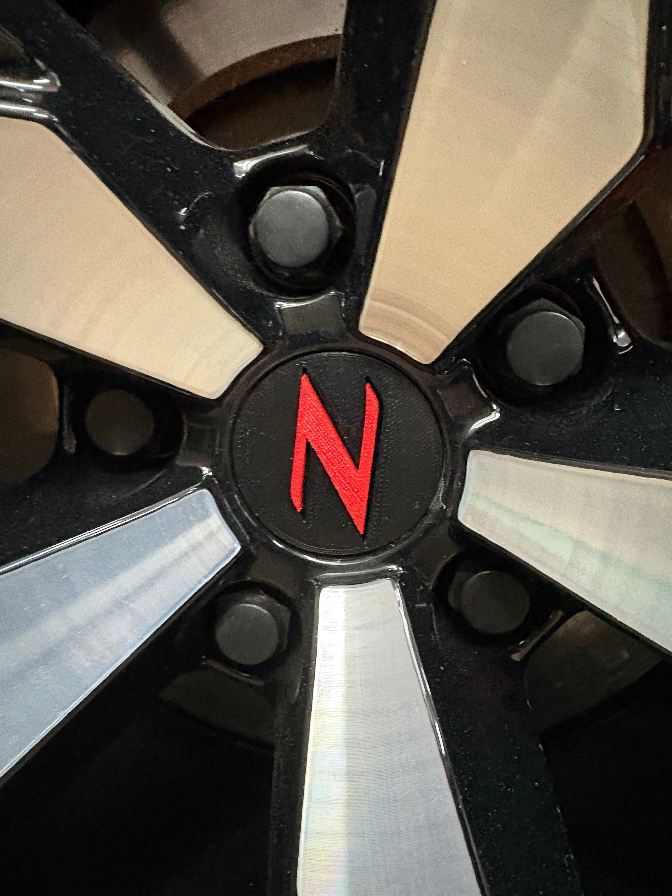
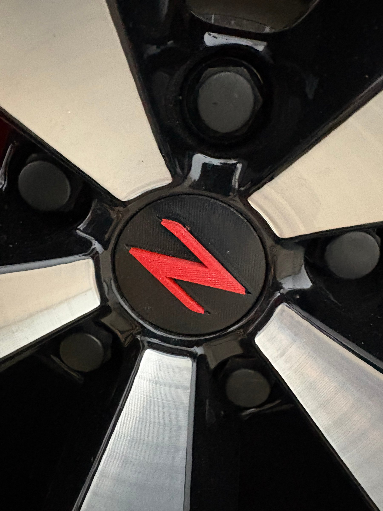
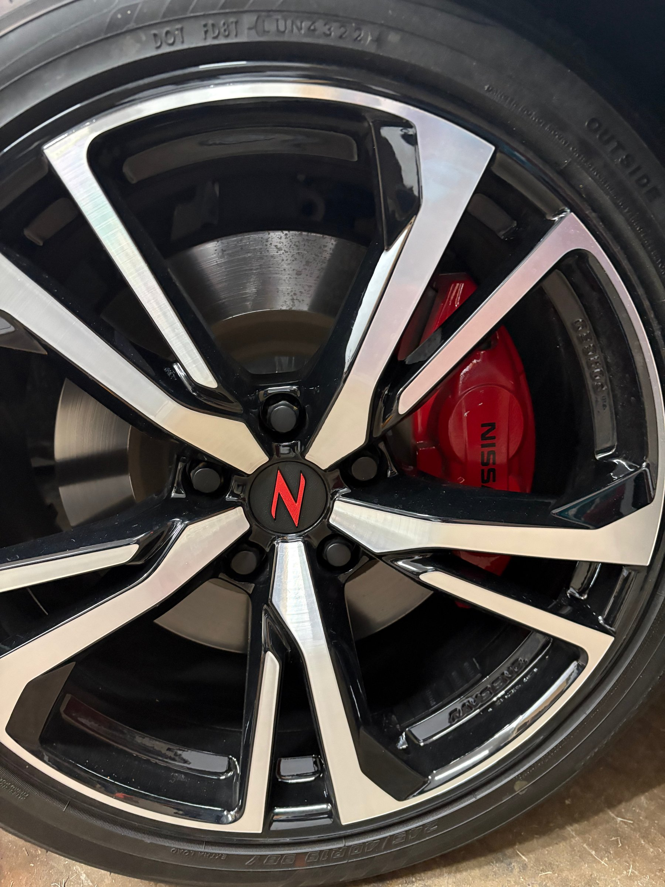
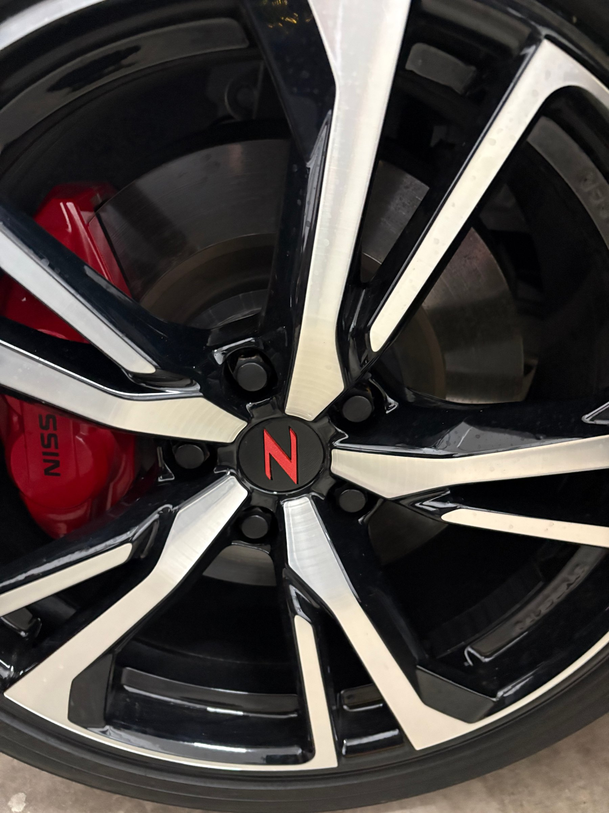

# wheel center caps

Licensed CC BY-SA 4.0 (see the repository [LICENSE](../../LICENSE)). Credit: 50th Z.

- **Fits (model years / trim):** TBD
- **Recommended material:** TBD
- **Print settings (layer height, infill, supports, orientation):** TBD
- **Install notes / hardware needed:** TBD
- **Changelog:** TBD

Files marked `source` are editable originals (STEP/Fusion). The top-level files are print-ready.

## Photos

Real prints and installs (location and device data removed). Click an image for full size.

<table>
<tr><td></td><td></td><td></td></tr>
<tr><td></td></tr>
</table>
